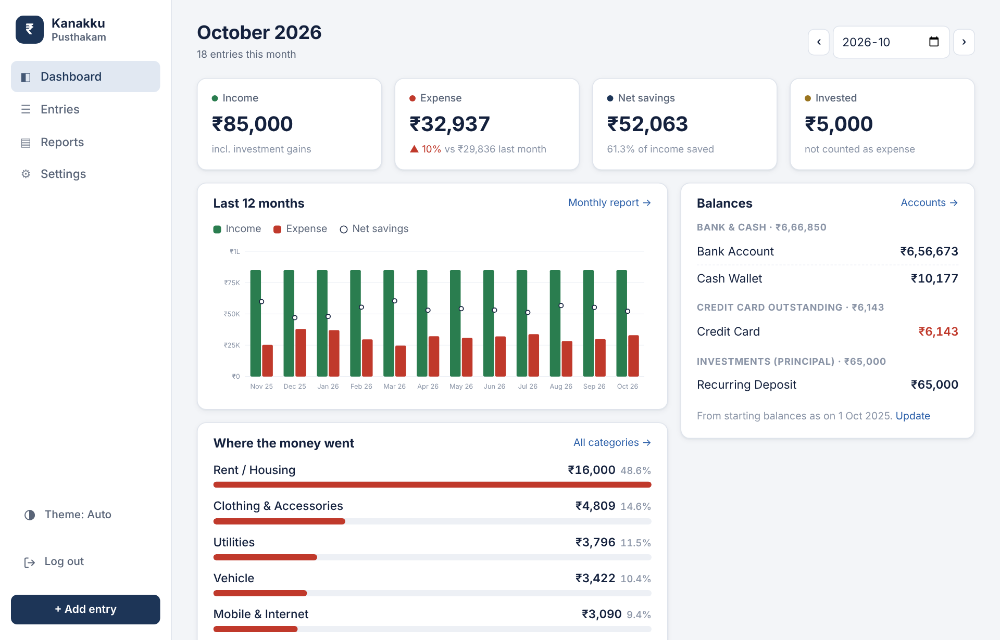
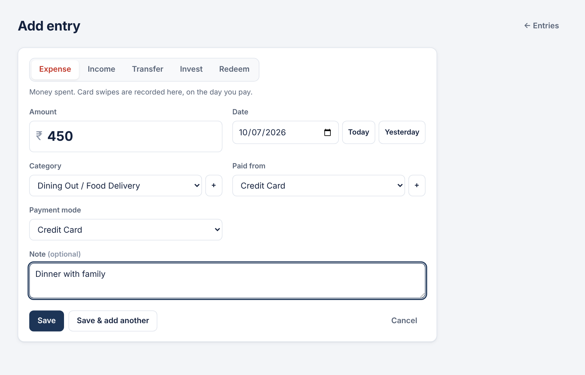
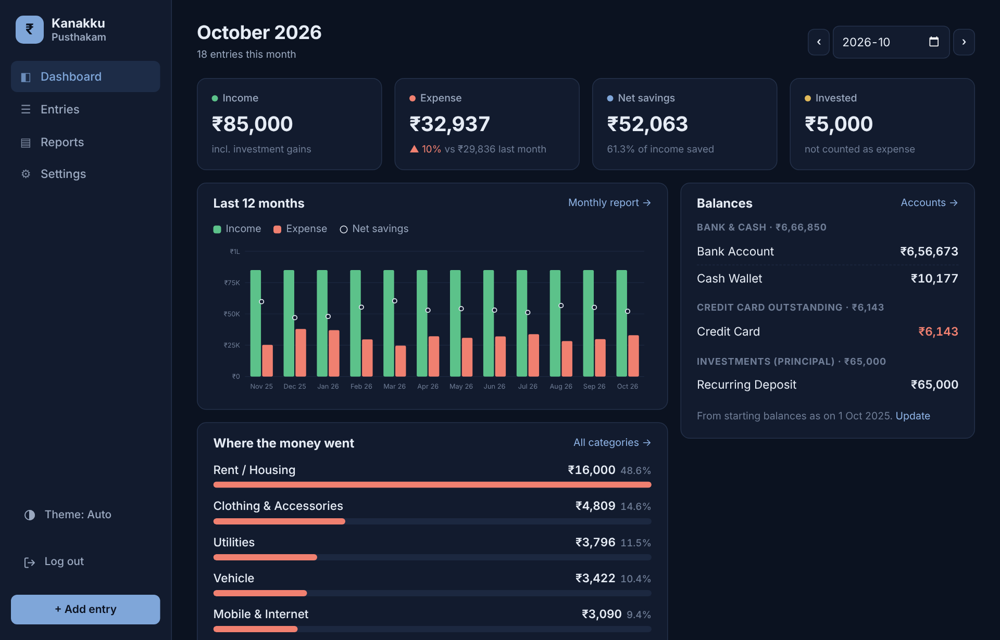
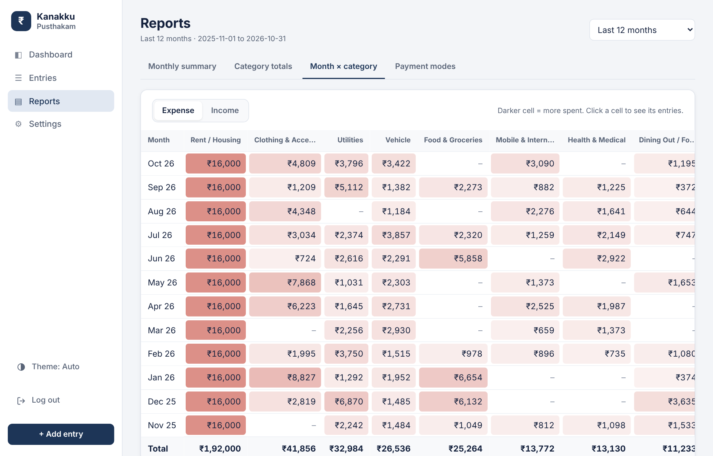
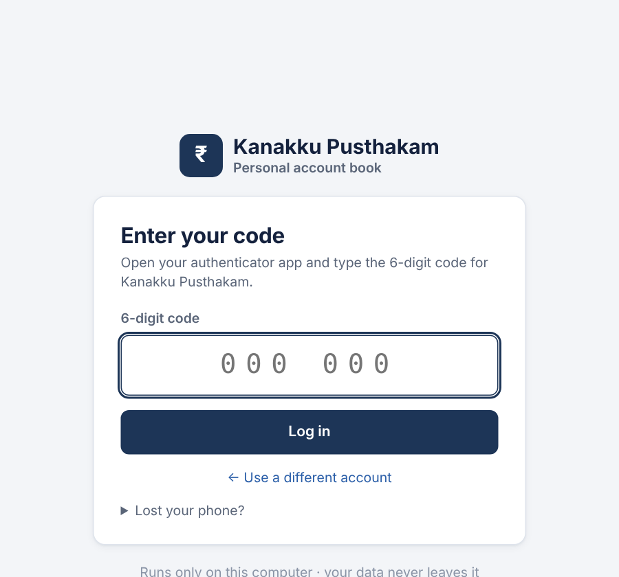

# Kanakku Pusthakam

**A private, offline personal account book.** Track income, expenses, credit cards and investments, and see
where your money goes: month by month and category by category. It runs on your own computer; your data never
leaves it.

*Kanakku Pusthakam (കണക്കു പുസ്തകം) is Malayalam for "account book".*

> **Currently available for Linux only.**



## Quick start (Linux)

You need **Python 3.10 or newer**. Most current Linux distributions already have it: check with `python3 --version`.

```bash
git clone <this repository's URL> kanakku-pusthakam   # or: Code → Download ZIP, then unzip
cd kanakku-pusthakam
./start.sh
```

Your browser opens at `http://127.0.0.1:5000`. Create your login, scan the QR code with an authenticator app,
enter your starting balances, and you're ready. There's nothing to install: no `pip`, no internet needed.

**Just want to look around first?** Run `python3 run.py --demo --open` for the app with a year of sample data.
It's stored separately in `demo-data/` and never mixes with your real data.

Stop the app with **Ctrl+C** in the terminal.

## Features

- **Fast entry:** expense, income, transfer, invest and redeem, with today's date pre-filled and the payment mode
  (UPI, card, cash…) picked from the account
- **Credit cards done right:** a card swipe is the expense; paying the bill is a transfer, so nothing is counted twice.
  The dashboard shows what you owe on each card
- **Investments aren't spending:** chitty, RD, FD, mutual fund instalments are tracked as principal; when they
  mature only the gain (or loss) counts as income
- **Reports:** monthly income / expense / savings, category totals, a month × category heat map,
  spending by payment mode; any period including the Indian financial year (Apr–Mar)
- **Starting balances "as on" a date** for every bank account, card, cash and investment
- **Secure login:** password + authenticator app (Google / Microsoft Authenticator, Authy), password reset by email
- **Light, dark and auto theme**, works on phone-sized screens
- **Your data stays yours:** one SQLite file, automatic daily backups, CSV export for Excel

| | |
| --- | --- |
|  |  |
|  |  |

## How it counts money

| Entry type | Example | Counts as |
| --- | --- | --- |
| Expense | ₹450 dinner paid with a credit card | Expense, on the day you pay |
| Income | Salary credited to your bank | Income |
| Transfer | Paying the credit card bill; ATM withdrawal | Neither, so nothing is counted twice |
| Invest | ₹5,000 RD instalment | "Invested", not an expense |
| Redeem | RD matures: ₹63,200 back for ₹60,000 put in | Only the ₹3,200 gain is income |

## Your data

- Everything is in `data/expenses.db` (git-ignored). Back it up by copying the `backups/` folder somewhere safe.
- A backup is taken automatically on the first start each day and before any database upgrade.
  **Settings → Backup & export** makes one on demand and exports all entries to CSV.
- To restore: stop the app, copy a file from `backups/` over `data/expenses.db`, start again.
- Updating the app (`git pull`) never touches your data; database changes are applied automatically.

## Login and recovery

- **Forgot password:** the login screen emails a one-time reset link. Set up the mail account first in
  **Settings → Security** (for Gmail, use an *App password*).
- **No email set up?** Stop the app and run `python3 run.py --reset-password`.
- **Lost your phone?** Run `python3 run.py --reset-mfa` and scan a new QR code at the next login.

See [SECURITY.md](SECURITY.md) for what the login does and doesn't protect.

## Project layout

```
├── run.py                 start the app (--open, --port, --demo, --reset-password, --reset-mfa)
├── start.sh               start + open the browser
├── backend/               Flask JSON API
│   ├── api/               HTTP routes, one blueprint per feature
│   ├── services/          business rules and SQL (entries, reports, auth, TOTP, email)
│   └── migrations/        numbered SQL files, applied automatically on start
├── frontend/              HTML, CSS and plain JavaScript modules (no build step)
├── tests/                 python3 -m unittest discover tests -v
├── docs/DESIGN.md         design: data model, rules, API, security
├── vendor/                Flask bundled as one zip (see vendor/LICENSES.md)
└── tools/build_vendor.py  rebuilds the bundled zip
```

## Development

```bash
python3 -m unittest discover tests -v     # 25 tests, uses a temporary database
python3 run.py --demo                     # sample data for trying changes
```

Database changes go in a new `backend/migrations/NNN_name.sql`. New features: a blueprint in `backend/api/`,
logic in `backend/services/`, a view in `frontend/js/views/`. See [docs/DESIGN.md](docs/DESIGN.md).

Planned: investment tracking with current value and net worth, budgets, recurring entries, bank statement import,
Windows and macOS support.

## License

[MIT](LICENSE). Bundled libraries keep their own licences, see [vendor/LICENSES.md](vendor/LICENSES.md).
